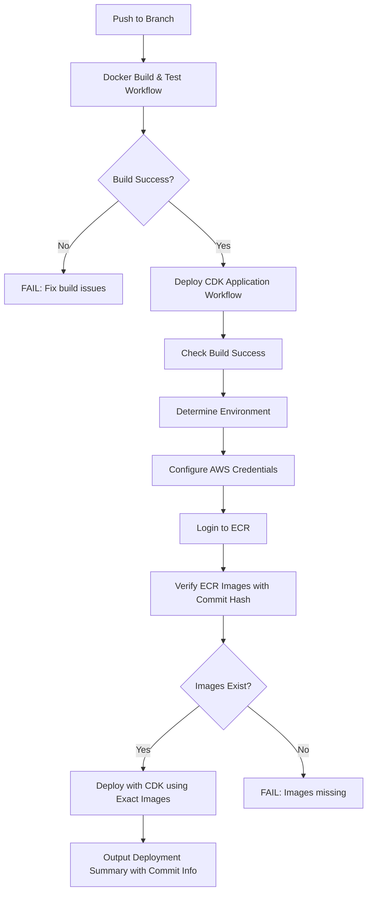

# Pipeline Consolidation Summary

## Changes Made

### ✅ **Enhanced `deploy.yml` Workflow**
- **Kept existing working pipeline** as the foundation
- **Added AWS ECR integration** for pre-built container images
- **Added intelligent image selection** (ECR first, fallback to source build)
- **Added manual workflow dispatch** for on-demand deployments
- **Maintained backward compatibility** with existing secrets and structure

### ❌ **Removed Redundant `deploy-aws.yml`**
- Consolidated functionality into the proven `deploy.yml` workflow
- Eliminated duplicate pipeline maintenance

## Key Features Added

### 🔍 **Smart Image Detection**
```bash
# The workflow automatically checks if ECR images exist:
aws ecr describe-images --repository-name emery/frontend --image-ids imageTag=main
```

### 🚀 **Standard ECR Deployment Strategy**
1. **Required**: Use pre-built ECR images (fast deployment)
2. **Fail-fast**: Exit with error if ECR images don't exist (standard AWS pattern)

### 🎛️ **Enhanced Environment Support**
- **Automatic**: Push to `main` → production, `staging` → staging, `develop` → dev
- **Manual**: Workflow dispatch with environment selection dropdown

### 🔧 **Flexible Authentication**
- **Preferred**: IAM roles via `AWS_ROLE_TO_ASSUME` (more secure)
- **Fallback**: Access keys via `AWS_ACCESS_KEY_ID` + `AWS_SECRET_ACCESS_KEY`

## Workflow Logic



## Benefits

### ⚡ **Performance**
- **Fast deploys** using pre-built ECR images (no build time)
- **Predictable deployment times** (no variable build duration)

### 🛡️ **Reliability**
- **Standard AWS ECR pattern** following best practices
- **Fail-fast feedback** when images missing (clear error messages)
- **Prevents unexpected build failures** during deployment

### 🧹 **Maintenance**
- **Single pipeline** to maintain instead of two
- **Consistent deployment logic** across all environments
- **Unified documentation** and troubleshooting

## Usage

### Automatic Deployment
```bash
# Push to any tracked branch triggers deployment
git push origin main     # → production environment
git push origin staging  # → staging environment  
git push origin develop  # → dev environment
```

### Manual Deployment
1. Go to GitHub Actions tab
2. Select "Deploy CDK Application" 
3. Choose environment from dropdown
4. Click "Run workflow"

### Local Testing
```bash
# Set environment variables to use ECR images
export FRONTEND_IMAGE_URI="123456.dkr.ecr.ap-southeast-2.amazonaws.com/emery/frontend:main"
export AGENT_IMAGE_URI="123456.dkr.ecr.ap-southeast-2.amazonaws.com/emery/agent:main"

# Deploy with CDK (will use ECR images)
cd infra && cdk deploy
```

## Required Secrets

### For ECR + Role-based Auth (Recommended)
```
AWS_ROLE_TO_ASSUME=arn:aws:iam::123456789012:role/GitHubActionsRole
AWS_ACCOUNT_ID=123456789012
```

### For Access Key Auth (Fallback)
```
AWS_ACCESS_KEY_ID=AKIA...
AWS_SECRET_ACCESS_KEY=secret...
AWS_ACCOUNT_ID=123456789012
```

## Next Steps

1. **Run the Docker build workflow** first to populate ECR with images
2. **Test the enhanced deployment pipeline** with clear fail-fast behavior  
3. **Monitor deployment logs** for ECR image verification steps
4. **Enjoy predictable, fast deployments** using standard AWS patterns! 🚀

## Automatic Workflow Dependencies

**NEW**: Workflows now run automatically in the correct order:

### 🔄 **Automatic Chain**
1. **Push to branch** → Triggers `Docker Build & Test` workflow
2. **Build completes successfully** → Automatically triggers `Deploy CDK Application` workflow  
3. **Build fails** → Deployment workflow won't run (prevents bad deployments)

### 🎯 **Exact Version Deployment**
- Images are tagged with git commit hash: `{branch}-{commit-sha}`
- Example: `develop-a1b2c3d` (develop branch, commit a1b2c3d)
- **Guarantees** exact same code deployed that was tested

### 🛡️ **Fail-Safe Features**
- Deploy only runs if Docker build succeeds
- Deploy verifies exact commit hash images exist
- Clear error messages if dependencies missing

### 📱 **Manual Override Available**  
You can still manually trigger deployment via GitHub Actions UI for:
- Hotfixes without rebuilding
- Rolling back to previous versions
- Testing different environments