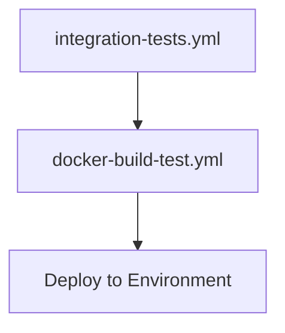

# GitHub Actions Workflows

This directory contains CI/CD workflows for the Emery platform.

## Workflow Dependencies

## Workflows

### 1. integration-tests.yml
**Purpose**: Runs comprehensive integration tests before any build/deploy operations.

**Triggers**:
- Push to any branch  
- Pull requests to main/staging/develop
- Called by other workflows (`workflow_call`)

**What it tests**:
- ✅ RLS (Row Level Security) multi-tenant isolation
- ✅ Database migrations apply correctly
- ✅ Python agent functionality 
- ✅ TypeScript type checking
- ✅ Code linting

**Database**: Uses PostgreSQL with pgvector extension in GitHub Services

**Key Features**:
- Isolated test database (port 5434)
- Comprehensive RLS policy testing
- Agent integration testing
- Multi-language testing (Python + TypeScript)

### 2. docker-build-test.yml (Build & Deploy)
**Purpose**: Builds Docker images and deploys to AWS environments.

**Dependencies**: 
- ⚠️ **REQUIRES** `integration-tests.yml` to pass first
- Will not run if integration tests fail

**Triggers**:
- Push to main/staging/develop (after integration tests pass)
- Pull requests (builds only, no deploy)

**What it does**:
1. **Wait for Integration Tests** ✋
2. Build frontend Docker image
3. Build agent Docker image  
4. Deploy to AWS via CDK (push only)

### 3. ci.yml (Quality Checks)  
**Purpose**: Basic quality checks that run in parallel.

**What it does**:
- Code linting
- TypeScript type checking
- Fast quality gate

## Integration Test Strategy

### Test Coverage
- **RLS Policies**: 16 comprehensive tests
- **Multi-tenancy**: Organization isolation
- **Vector Search**: RAG functionality with organization scoping
- **Database**: Migration consistency

### Test Environment
- **PostgreSQL**: pgvector/pgvector:pg17 image
- **Isolated**: Dedicated test database
- **Clean**: Fresh database per test run
- **Realistic**: Same Docker images as production

## Deployment Flow

1. **Developer pushes code** → Integration tests run automatically
2. **Integration tests pass** → Docker build/test workflow starts  
3. **Docker build succeeds** → Deploy to environment (main/staging/develop)
4. **Integration tests fail** → ❌ No build, no deploy

## Benefits

✅ **Safety**: No broken code reaches deployment  
✅ **Fast Feedback**: Integration issues caught early  
✅ **Confidence**: Comprehensive test coverage  
✅ **Automation**: No manual intervention needed  
✅ **Multi-tenant Security**: RLS policies verified on every commit