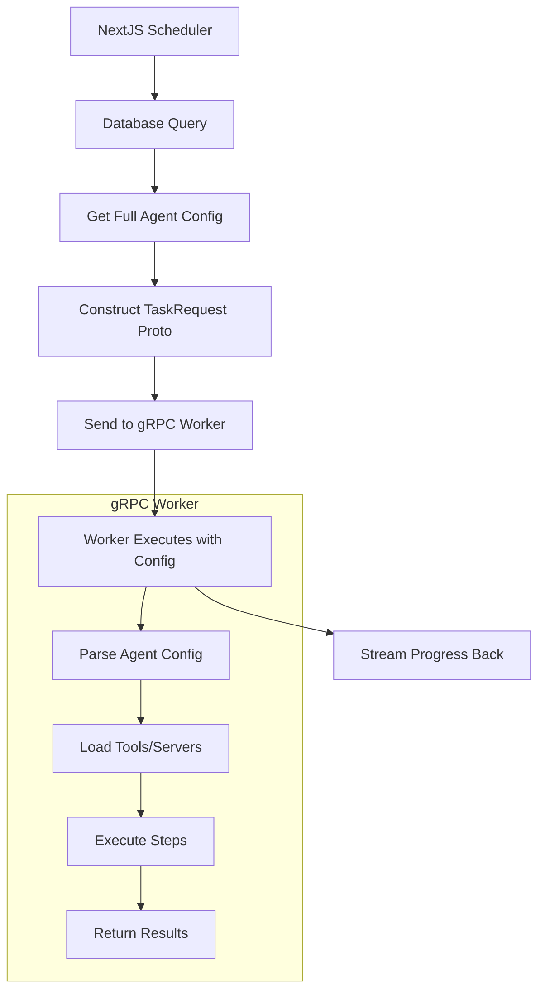
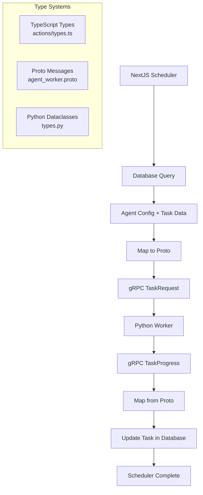

# Proto-Based Agent Execution Architecture Plan

## Current Issues

### 1. **Dual Entry Points**
```toml
[project.scripts]
emery-agents = "emery_agents.cli:main"      # ❌ CLI with env vars
emery-worker = "emery_agents.grpc.server_simple:main"  # ✅ gRPC server
```

### 2. **Environment Variable Anti-Pattern**
```python
# ❌ Current CLI approach - gets config from env vars
config_json = os.getenv("EMERY_AGENT_CONFIG")
trigger_json = os.getenv("EMERY_TRIGGER_DATA", "{}")
```

### 3. **Incomplete Proto Definition**
```protobuf
// ❌ Current: Only has trigger_data_json as string
message TaskRequest {
  string trigger_data_json = 4;    // Incomplete - missing full agent config
}
```

### 4. **Type System Misalignment**
- TypeScript: `ToolConfig[]`, `StepConfig[]`, `CapabilityConfig[]`
- Proto: Only basic `trigger_data_json` string
- Python: Mix of dataclasses + env parsing

## Proposed Solution: Proto-First Architecture

### 1. **Single Entry Point**
```toml
[project.scripts]
emery-worker = "emery_agents.grpc.server:main"  # Only this
# ❌ Remove: emery-agents = "emery_agents.cli:main"
```

### 2. **Enhanced Proto Definition**
```protobuf
// ✅ Complete agent configuration via proto
message TaskRequest {
  string task_id = 1;
  int32 agent_id = 2;
  string capability_name = 3;
  AgentConfig agent_config = 4;     // 🆕 Full agent configuration
  TriggerData trigger_data = 5;     // 🆕 Structured trigger data
  string organization_id = 6;
  string owner_id = 7;
  int32 timeout_seconds = 8;
}

message AgentConfig {
  string name = 1;
  string role = 2;
  string description = 3;
  string persona = 4;
  repeated ToolConfig tools = 5;         // 🆕 Tool configurations
  repeated ServerConfig servers = 6;     // 🆕 Server configurations  
  repeated CapabilityConfig capabilities = 7; // 🆕 All capabilities
}

message CapabilityConfig {
  string name = 1;
  string description = 2;
  repeated StepConfig steps = 3;         // 🆕 Step configurations
}

message StepConfig {
  string id = 1;
  StepType type = 2;                     // 🆕 Enum instead of string
  string instructions = 3;
  string model = 4;                      // 🆕 Per-step model
  repeated ToolConfig tools = 5;         // 🆕 Step-level tools
  repeated ServerConfig servers = 6;     // 🆕 Step-level servers
}

message ToolConfig {
  string name = 1;
  string version = 2;
  map<string, string> config = 3;       // 🆕 Tool configuration
}

message ServerConfig {
  string name = 1;
  string endpoint = 2;
  map<string, string> config = 3;       // 🆕 Server configuration
}

enum StepType {
  CODE_STEP = 0;
  TOOL_STEP = 1;
}

message TriggerData {
  map<string, string> payload = 1;      // 🆕 Flexible trigger payload
}
```

### 3. **Data Flow Architecture**



### 4. **Implementation Steps**

#### Phase 1: Enhanced Proto Definition
- [ ] Update `proto/agent_worker.proto` with complete type system
- [ ] Regenerate protobuf files for both TypeScript and Python
- [ ] Update gRPC client/server to use new message types

#### Phase 2: NextJS Integration
- [ ] Update `lib/agents/grpc-executor.ts` to send full agent config
- [ ] Remove environment variable dependencies
- [ ] Query database for complete agent configuration before gRPC call

#### Phase 3: Python Worker Simplification  
- [ ] Remove `emery-agents` CLI entry point
- [ ] Update `emery-worker` to receive config via proto only
- [ ] Remove environment variable parsing logic
- [ ] Map proto messages directly to dataclasses

#### Phase 4: Type System Alignment
- [ ] Generate Python dataclasses from proto definitions
- [ ] Ensure TypeScript types match proto definitions exactly
- [ ] Update database JSONB schemas to align with proto

### 5. **Benefits**

#### ✅ **Simplified Architecture**
- Single entry point: `emery-worker`
- No environment variable configuration
- All data transported via structured proto messages

#### ✅ **Type Safety**
- Proto definitions are source of truth
- Automatic validation of message structure
- Consistent types across TypeScript/Python/Database

#### ✅ **Better Debugging**
- Full agent configuration visible in gRPC logs
- No hidden environment variable dependencies
- Clear data flow from database → proto → execution

#### ✅ **Scalability**
- Workers are stateless (no config dependencies)
- Easy to add new fields to proto without breaking changes
- Proto versioning support

### 6. **Migration Strategy**

#### Step 1: Add New Proto Messages (Non-Breaking)
```protobuf
// Add new fields while keeping old ones
message TaskRequest {
  // Old fields (keep for compatibility)
  string trigger_data_json = 4;
  
  // New fields  
  AgentConfig agent_config = 8;
  TriggerData trigger_data = 9;
}
```

#### Step 2: Update NextJS to Send Both Formats
```typescript
const taskRequest = {
  // Old format (for compatibility)
  trigger_data_json: JSON.stringify(triggerData),
  
  // New format (structured)
  agent_config: mapAgentToProto(agent),
  trigger_data: { payload: triggerData }
};
```

#### Step 3: Update Python to Prefer New Format
```python
def execute_task(request):
    if request.agent_config:
        # ✅ Use new structured config
        agent = parse_proto_agent_config(request.agent_config)
    else:
        # 🔄 Fallback to old env-based config
        agent = parse_env_agent_config()
```

#### Step 4: Remove Old Format
- Remove environment variable logic
- Remove `trigger_data_json` field from proto
- Remove CLI entry point

### 7. **File Changes Required**

#### Delete/Simplify
- ❌ `emery-agents/src/emery_agents/cli.py` (remove entry point)
- ❌ Environment variable parsing logic
- ✅ Keep only `emery-worker` entry point

#### Update
- `proto/agent_worker.proto` - Add complete type system
- `lib/agents/grpc-executor.ts` - Send full agent config
- `emery-agents/src/emery_agents/grpc/server_simple.py` - Receive proto config
- `emery-agents/pyproject.toml` - Remove CLI entry point

#### Generate
- Regenerate all protobuf files
- Update type definitions to match proto

### 8. **Frontend Types Strategy**

#### Keep `app/actions/types.ts` as Source of Truth
The frontend and database should continue using the existing TypeScript types:

```typescript
// ✅ Keep these as primary types for NextJS app
interface ToolConfig { name: string; version?: string; config?: Record<string, any>; }
interface StepConfig { id: string; type: 'CODE_STEP' | 'TOOL_STEP'; instructions: string; model?: string; tools?: ToolConfig[]; servers?: ServerConfig[]; }
interface CapabilityConfig { name: string; description: string; steps: StepConfig[]; }
interface Task { id: string; agentId: number; name: string; capabilityName: string; status: string; payload: Record<string, any>; result?: any; error?: string; startedAt?: Date; completedAt?: Date; }
```

#### Proto as Transport Layer Only
Proto definitions serve purely as gRPC transport format:

```typescript
// lib/grpc/proto-mappers.ts
function mapAgentToProto(agent: AgentData): AgentConfigProto {
  return {
    name: agent.name,
    tools: agent.tools?.map(t => ({ name: t.name, version: t.version || "", config: t.config || {} })),
    capabilities: agent.capabilities?.map(mapCapabilityToProto),
    // ... etc
  };
}

function mapTaskFromProto(protoProgress: TaskProgressProto): Partial<Task> {
  return {
    status: protoProgress.status.toLowerCase() as TaskStatus,
    result: protoProgress.output_json ? JSON.parse(protoProgress.output_json) : undefined,
    error: protoProgress.error_message || undefined,
    // ... etc
  };
}
```

#### Data Flow Architecture


### 9. **Task Sync Pattern**

#### Scheduler → Worker → Database Flow
```typescript
// 1. Scheduler queries database for task and agent config
const task = await getTask(taskId);
const agent = await getAgent(task.agentId);

// 2. Map to proto and send to worker
const request = mapToTaskRequest(task, agent);
const progressStream = grpcClient.executeTask(request);

// 3. Update task with execution results
for await (const progress of progressStream) {
  await updateTaskProgress(progress);
}
```

#### Minimal Sync Requirements
Only task execution data flows back:

```typescript
async function updateTaskProgress(progress: TaskProgressProto) {
  await db.update(tasks)
    .set({
      status: mapProtoStatus(progress.status),
      result: progress.output_json ? JSON.parse(progress.output_json) : undefined,
      error: progress.error_message || undefined,
      completedAt: progress.status === 'TASK_COMPLETED' ? new Date() : undefined,
    })
    .where(eq(tasks.id, progress.task_id));
}
```

#### No Agent Config Sync Needed
- Agent configuration flows **one-way**: Database → Scheduler → Proto → Worker
- Worker executes with config but never modifies it
- Only task execution results flow back
- Clean separation of concerns

## Conclusion

This architecture maintains the existing NextJS type system while adding a clean gRPC transport layer. The **scheduler queries the database**, maps to proto, sends to worker, and updates task results. Proto serves as transport only - not as the source of truth for types.