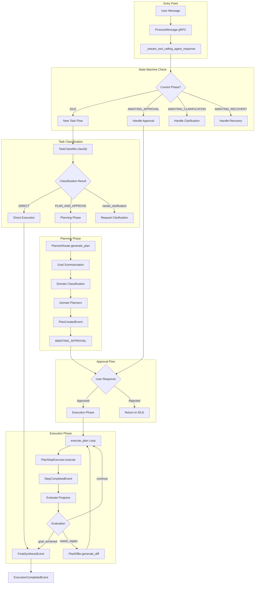
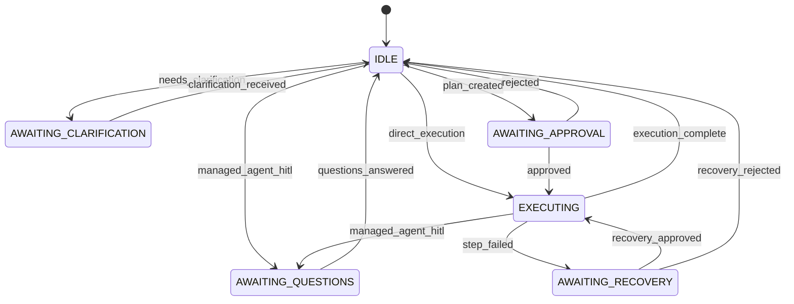
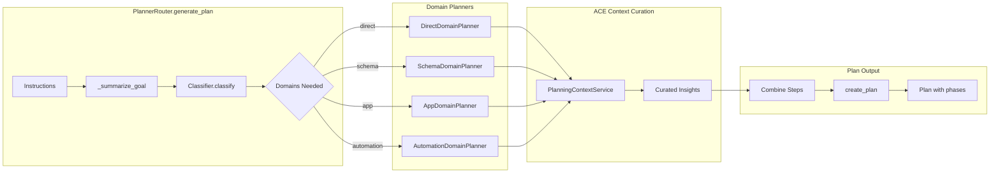
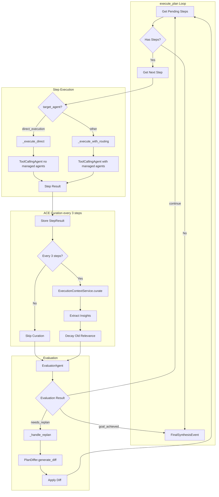
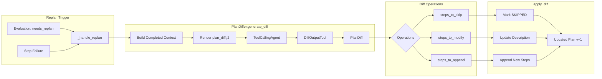
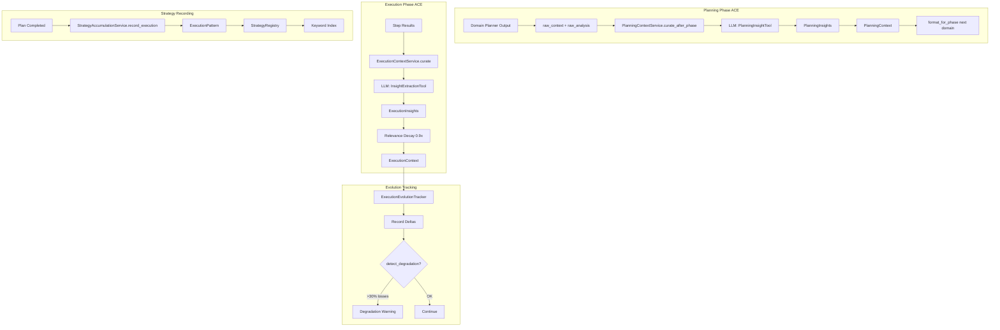
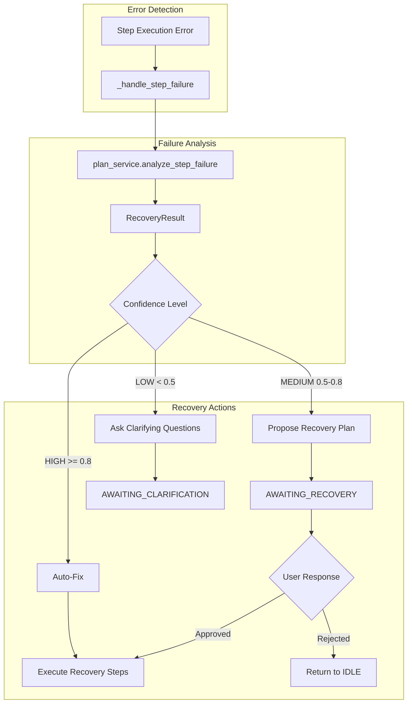
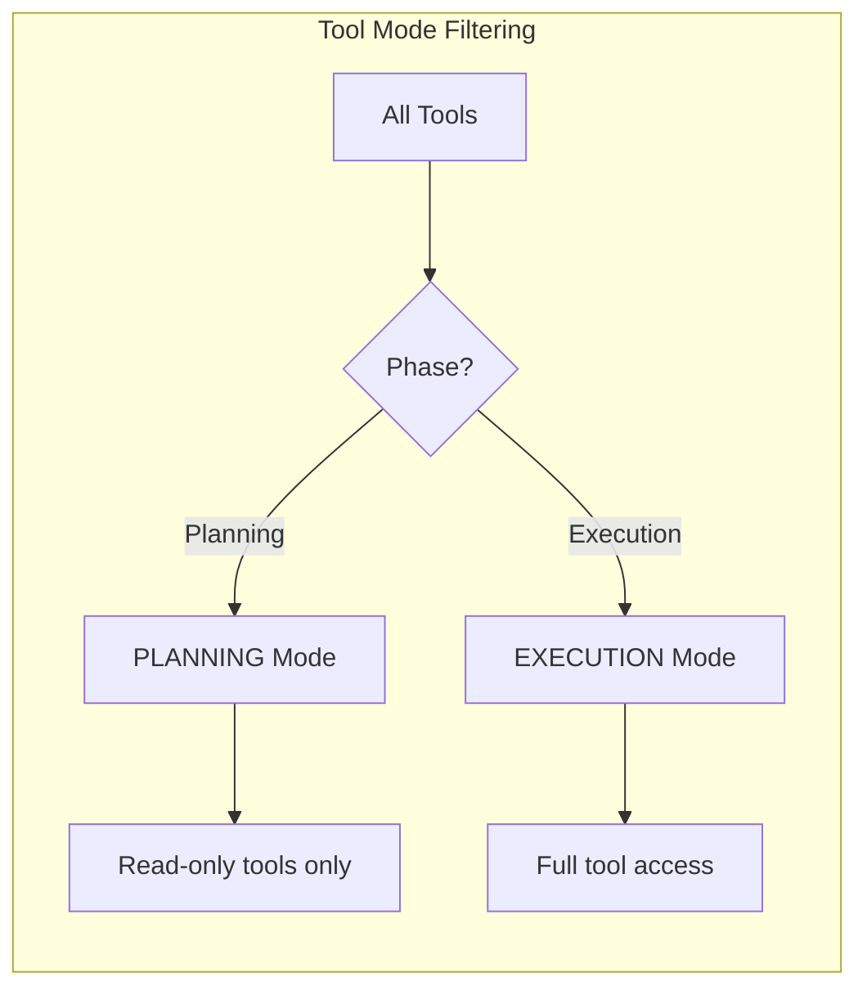

# Orchestration Flow Documentation

This document maps the complete orchestration flow from user message to execution completion.

## High-Level Flow

## State Machine Transitions

## Planning Phase Detail

### Domain Execution Order

| Order | Domain | Target Agent | Purpose |
|-------|--------|--------------|---------|
| 1 | direct | direct_execution | Pure LLM tasks (analysis, routing, transformation) |
| 2 | schema | skill_builder | Database/table operations |
| 3 | app | skill_builder | App/page/view operations |
| 4 | automation | skill_builder | Agent/skill/trigger creation |

## Execution Phase Detail

## Replanning Flow (Diff-Based)

## ACE Integration Points

## Error Recovery Flow

## Key File References

| Component | File | Key Lines |
|-----------|------|-----------|
| gRPC Entry | `grpc/chat_processing_service.py` | 298-302, 703-1200 |
| State Machine | `services/coordinator_state_machine.py` | 40-45, 102-128 |
| Coordinator | `services/execution_coordinator.py` | 525-651, 939-1558 |
| Planning Router | `services/planning/planners/planner_router.py` | 69-262 |
| Step Executor | `services/plan_step_executor.py` | 82-147, 149-293 |
| Plan Differ | `services/planning/plan_differ.py` | 181-371 |
| ACE Context | `ace/services/context_service.py` | 137-302 |
| ACE Strategy | `ace/services/strategy_service.py` | 86-295 |

## Event Types

| Event | Emitted By | Purpose |
|-------|-----------|---------|
| `PlanCreatedEvent` | ExecutionCoordinator | Plan ready for approval |
| `PlanApprovedEvent` | ExecutionCoordinator | Plan approved, starting execution |
| `StepStartedEvent` | ExecutionCoordinator | Step execution beginning |
| `StepCompletedEvent` | ExecutionCoordinator | Step finished successfully |
| `StepFailedEvent` | ExecutionCoordinator | Step execution failed |
| `EvaluationCompletedEvent` | ExecutionCoordinator | Evaluator finished assessment |
| `ReplanTriggeredEvent` | ExecutionCoordinator | Replanning initiated |
| `PlanUpdatedEvent` | ExecutionCoordinator | Plan modified via diff |
| `PhaseStartedEvent` | ExecutionCoordinator | New phase beginning |
| `PhaseCompletedEvent` | ExecutionCoordinator | Phase finished |
| `FinalSynthesisEvent` | ExecutionCoordinator | Final answer synthesized |
| `ExecutionCompletedEvent` | ExecutionCoordinator | All execution complete |
| `AwaitingClarificationEvent` | ExecutionCoordinator | Needs user input |
| `RecoveryAnalysisEvent` | ExecutionCoordinator | Recovery analysis complete |

## Tool Modes

| Mode | Description | Tools Available |
|------|-------------|-----------------|
| PLANNING | Read-only discovery | list_tables, describe_table, list_apps, etc. |
| EXECUTION | Full operations | create_table, update_record, create_app, etc. |
