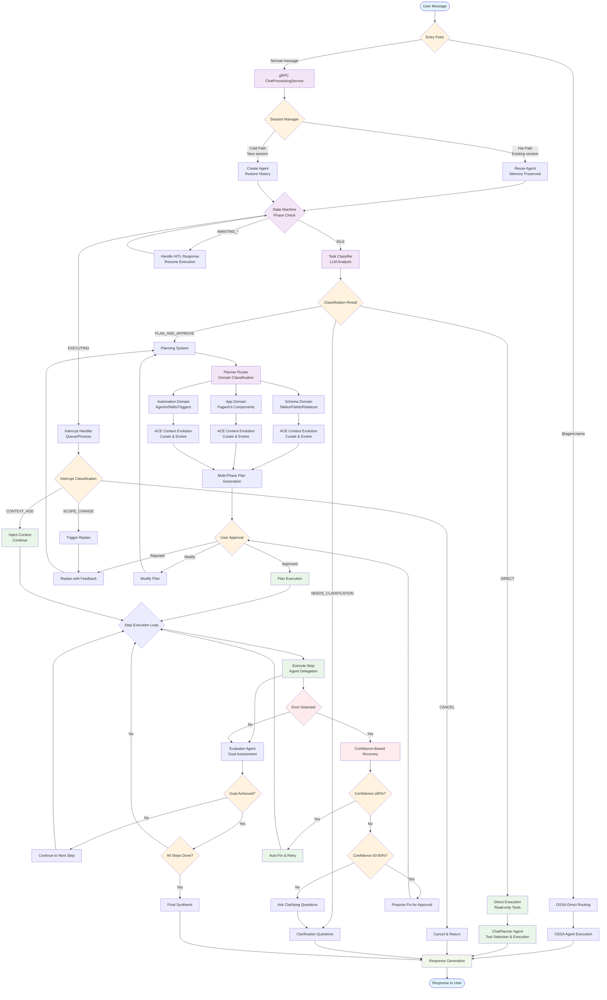

# Chat Message and Planning Flow Analysis

## System Overview

The Emery Agents chat processing system implements a sophisticated multi-layered architecture that intelligently routes user messages through appropriate execution paths, from simple direct responses to complex multi-phase planning with human-in-the-loop (HITL) capabilities.

---

## Context Flow Diagram



---

## Flow Analysis by Component

### 1. Entry Points and Initial Processing

#### gRPC ChatProcessingService (`chat_processing_service.py`)
```python
async def ProcessMessage(request, context):
    """Main entry point for all chat messages"""
    # Extract components
    text = request.message.text
    images = request.message.images
    attachments = request.message.attachments
    
    # Session management
    session = await session_manager.get_or_create_session(
        user_id=request.user_id,
        session_id=request.session_id
    )
    
    # Route based on message content
    if mention_parser.parse_agent_mention(text):
        return await mention_routing.handle_direct_routing(request)
    else:
        return await execution_coordinator.execute(
            task=text,
            images=images,
            attachments=attachments,
            session=session
        )
```

#### OSSA Direct Routing
```python
# Special path for @agent:name mentions
if agent_name := mention_parser.parse_agent_mention(message):
    agent_config = await api.get_agent_by_name(agent_name)
    agent_executor = AgentExecutor(agent_config)
    return await agent_executor.run(extracted_task)
```

### 2. Session Management

#### Hot Path vs Cold Path
```python
# Hot Path: Existing session with preserved agent memory
if session.agent and not session.agent.is_expired():
    agent = session.agent  # Reuse existing agent
    agent.reset(False)     # Preserve memory across messages
    
# Cold Path: New session or expired agent
else:
    agent = create_new_agent(
        managed_agents=create_all_managed_agents(),
        tools=get_user_tools()
    )
    if conversation_history:
        agent.restore_memory(conversation_history)
```

#### File Attachment Accumulation
```python
# Files accumulate in session for cross-message access
if attachments:
    session.add_attachments(attachments)
    # Available to all subsequent messages in session
```

### 3. Task Classification (LLM-Based)

#### TaskClassifier Logic
```python
class TaskClassification:
    mode: ExecutionMode  # DIRECT | PLAN_AND_APPROVE
    needs_clarification: bool
    target_agent: Optional[str]
    confidence: float

# LLM prompt example
def classify_task(user_input: str) -> TaskClassification:
    prompt = f"""
    Classify this user request: "{user_input}"
    
    Return:
    - mode: "DIRECT" for simple, complete commands
    - mode: "PLAN_AND_APPROVE" for complex, multi-step tasks
    - needs_clarification: true if request is ambiguous
    - target_agent: specific agent if clearly indicated
    """
```

### 4. Direct Execution Path

#### Simple Request Flow
```
User: "Show me all users in the database"
    ↓
TaskClassifier: mode=DIRECT, target_agent=None
    ↓
ChatPlanner.run() with read-only tools
    ↓
Tool selection: table_crud.read("users")
    ↓
Immediate response with user data
```

#### Available Tools (Read-only)
- `table_crud`: list, read
- `database_crud`: list, read  
- `skill_crud`: list, read
- `document_crud`: list, read
- Research tools: DuckDuckGoSearch, VisitWebpage

### 5. Complex Planning Flow

#### Domain Classification
```python
# PlannerRouter.classify_domains()
domains = [
    "schema",      # Tables, fields, relations
    "app",         # Pages, views, UI components  
    "automation"   # Agents, skills, triggers
]

# LLM determines which domains are needed
classification = llm_classify(user_request, domains)
# Returns: ["schema", "app"] with confidence scores
```

#### Multi-Phase Domain Planning
```python
# Ordered execution: Schema → App → Automation
for domain in classification.domains:
    planner = get_domain_planner(domain)
    result = await planner.plan(
        goal=user_request,
        context=accumulated_context,
        previous_results=domain_results
    )
    
    # Context evolution between domains
    accumulated_context = ace_service.evolve_context(
        current_context=accumulated_context,
        new_insights=result.insights
    )
    domain_results.append(result)
```

#### Plan Generation Example
```
User: "Create a CRM system with customer management"
    ↓
Domain Classification: ["schema", "app", "automation"]
    ↓
Schema Domain Plan:
1. Create customers table with fields
2. Create deals table with relations
3. Create activities table
    ↓
Context Evolution: [DISCOVERY] Found customer entities
    ↓
App Domain Plan:
1. Create CRM app
2. Customer list page with search
3. Deal tracking dashboard
    ↓
Context Evolution: [DECISION] Using table-driven UI
    ↓
Automation Domain Plan:
1. Create follow-up skill for deals
2. Set up deal stage triggers
    ↓
Final Multi-Phase Plan with context preservation
```

### 6. Plan Execution with Intelligence

#### Step-by-Step Execution
```python
# PlanStepExecutor.execute_step()
async def execute_step(step):
    # 1. Build context for agent
    context = build_execution_context(
        current_step=step,
        completed_steps=completed_steps,
        accumulated_context=execution_context
    )
    
    # 2. Execute via managed agent
    result = await managed_agent.execute(step, context)
    
    # 3. Evaluate progress
    evaluation = await evaluator_agent.evaluate(
        goal=original_goal,
        current_result=result,
        progress=progress_metrics
    )
    
    # 4. Curate context (ACE)
    new_insights = await context_service.curate_insights(result)
    execution_context.add_insights(new_insights)
    
    # 5. Decide next action
    if not evaluation.goal_achieved and evaluation.replan_needed:
        return await trigger_replan(evaluation.feedback)
    
    return result
```

### 7. Interrupt Handling (HITL)

#### Interrupt Classification
```python
class InterruptType(Enum):
    CONTEXT_ADD = "context_add"      # Additional info
    SCOPE_CHANGE = "scope_change"    # Direction change  
    CANCEL = "cancel"               # Stop execution

def classify_interrupt(interrupt_message: str) -> InterruptType:
    # LLM classification of user intent
    return interrupt_classifier.classify(interrupt_message)
```

#### Interrupt Processing
```python
async def handle_interrupt(interrupt):
    match interrupt.type:
        case InterruptType.CONTEXT_ADD:
            # Inject into current execution
            execution_context.add_user_input(interrupt.content)
            return await resume_execution()
            
        case InterruptType.SCOPE_CHANGE:
            # Trigger replanning with new scope
            return await trigger_replan(interrupt.content)
            
        case InterruptType.CANCEL:
            # Clean shutdown
            return await cancel_execution()
```

---

## Scenario Examples

### Scenario 1: Simple Direct Query
```
User: "What tables exist in my database?"

Flow:
1. TaskClassifier: mode=DIRECT, confidence=0.95
2. Direct Execution: ChatPlanner with table_crud.list()
3. Response: ["users", "deals", "activities", "companies"]

Key Points:
- No planning phase
- Read-only tools only
- Immediate response
- Single-step execution
```

### Scenario 2: Complex Multi-Domain Planning
```
User: "Create a customer support ticket system"

Flow:
1. TaskClassifier: mode=PLAN_AND_APPROVE, domains=["schema", "app", "automation"]
2. Schema Domain Planning:
   - Create tickets table
   - Create customers table  
   - Create support_agents table
3. Context Evolution: [DISCOVERY] Ticket lifecycle identified
4. App Domain Planning:
   - Ticket list page with filters
   - Ticket detail view
   - Agent dashboard
5. Context Evolution: [DECISION] Role-based access needed
6. Automation Domain Planning:
   - Auto-assign tickets by category
   - Escalation rules
7. Plan Approval: User reviews complete plan
8. Execution: Step-by-step with evaluation

Key Points:
- Multi-phase domain planning
- Context evolution between phases
- User approval before execution
- Complex multi-step execution
```

### Scenario 3: Interrupt Handling During Execution
```
User: "Create a sales dashboard" → Plan approved → Execution starts
...during step 3...
User: "Actually, make it for customer support instead"

Flow:
1. Interrupt Classifier: SCOPE_CHANGE
2. Context Injection: "Switch focus from sales to customer support"
3. Dynamic Replanning:
   - Preserve completed steps (general setup)
   - Modify remaining steps for customer support domain
   - Update context with new direction
4. Continue modified execution

Key Points:
- Real-time interrupt processing
- Context preservation
- Dynamic plan modification
- Seamless execution continuation
```

### Scenario 4: Error Recovery with Confidence
```
Step: "Create customer view with permissions"
Result: Error - Permission denied

Flow:
1. Failure Analyzer: LLM assesses error
2. Confidence Score: 0.85 (high confidence fix available)
3. Auto-Fix Execution:
   - Try alternative permission approach
   - Use admin credentials
   - Implement row-level security
4. Retry with auto-fix
5. Success: Continue to next step

Key Points:
- Automated error recovery
- LLM confidence assessment
- Multiple fix strategies
- Transparent retry process
```

### Scenario 5: @Agent Direct Routing
```
User: "@agent:sales-assistant Generate Q3 sales report"

Flow:
1. Mention Parser: Extract "sales-assistant" 
2. OSSA Routing: Direct to sales-assistant agent
3. Agent Executor:
   - Load agent configuration
   - Apply specialized persona
   - Execute with sales-focused tools
4. Response: Generated report from agent

Key Points:
- Bypass planning system
- Direct agent execution
- Specialized tool access
- Agent-specific persona
```

### Scenario 6: File Attachment Processing
```
User: [Uploads CSV] "Create a skill to process this customer data"

Flow:
1. File Upload: CSV stored in session attachments
2. Context Injection: File metadata available to all agents
3. Task Classification: PLAN_AND_APPROVE (file analysis + skill creation)
4. Research Phase:
   - Analyze CSV structure
   - Identify data patterns
5. Planning Phase:
   - Design skill schema
   - Define processing steps
6. Execution:
   - Create skill with CSV processing tools
   - Configure file input handling

Key Points:
- Cross-message file persistence
- Context-aware file processing
- Multi-phase planning with file analysis
- Skill creation with file integration
```

---

## Key Architecture Features

### 1. Intelligent Classification
- LLM-based task classification replaces brittle string matching
- Context-aware routing decisions
- Confidence scoring for uncertainty handling

### 2. Phased Domain Planning
- Sequential domain processing (Schema → App → Automation)
- Context evolution between domains
- Accumulated insights guide subsequent phases

### 3. Adaptive Execution
- Real-time interrupt handling
- Dynamic replanning capabilities  
- Confidence-based error recovery
- Context preservation across modifications

### 4. Rich Context Management
- ACE (Adaptive Context Evolution) pattern
- Strategy accumulation from past executions
- Session-based file and memory persistence

### 5. Human-in-the-Loop Integration
- Multiple approval points (plans, fixes, scope changes)
- Transparent interrupt handling
- User control throughout complex operations

This architecture enables handling of everything from simple database queries to complex multi-domain automation workflows while maintaining user control, learning from experience, and adapting to changing requirements in real-time.