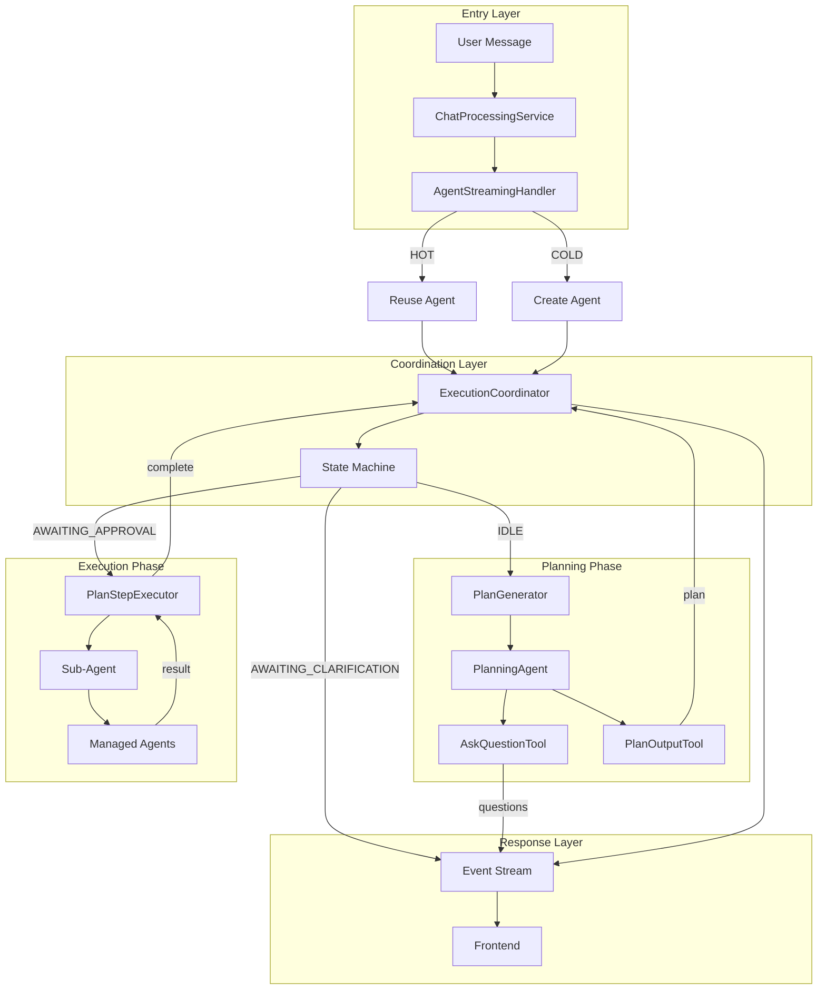
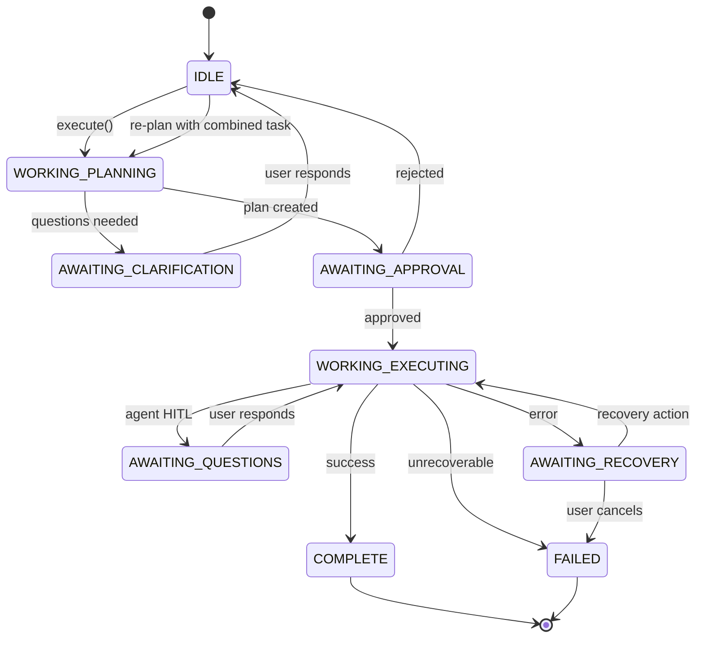
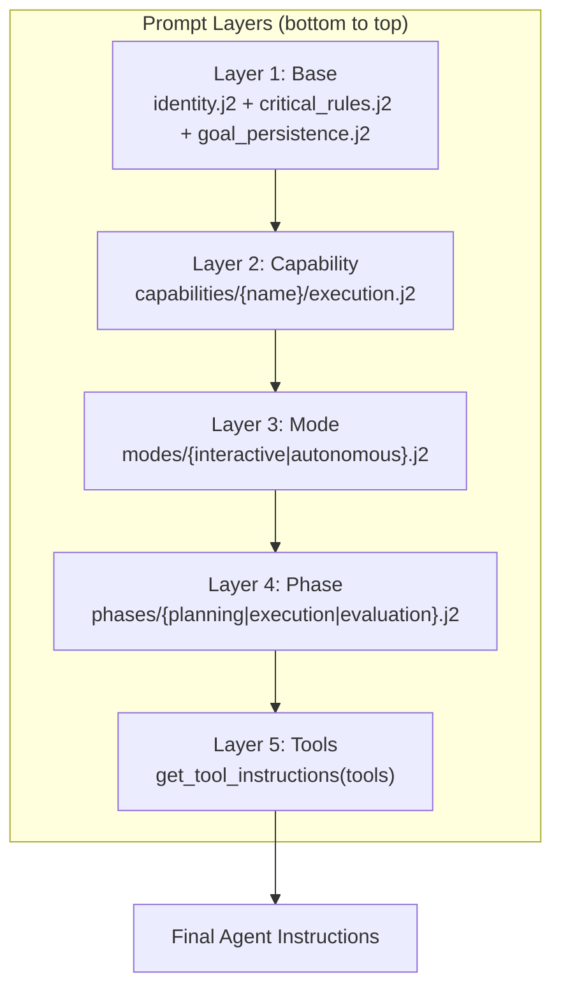
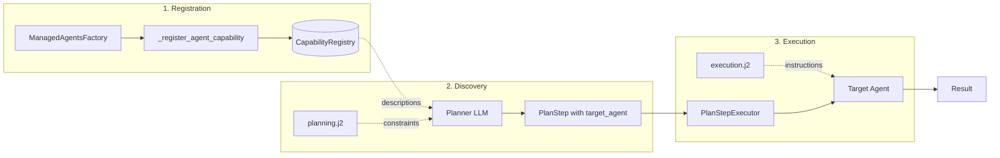
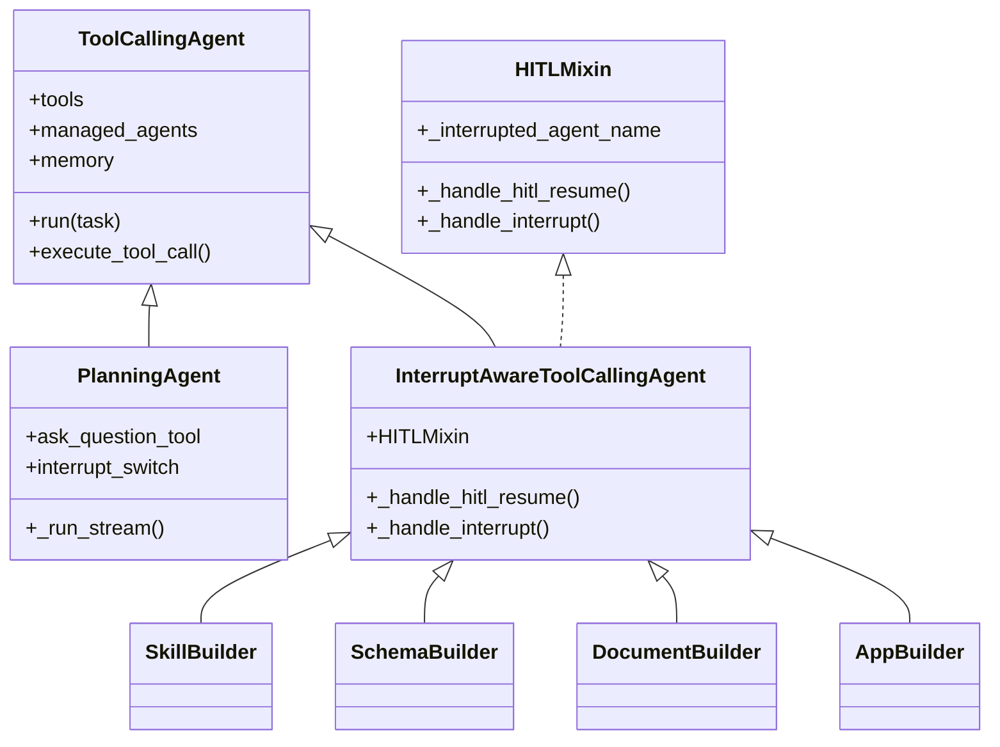
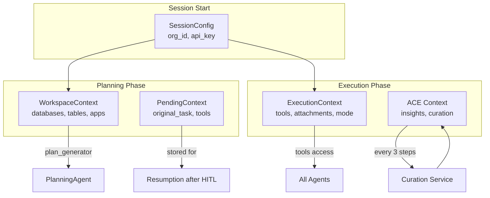
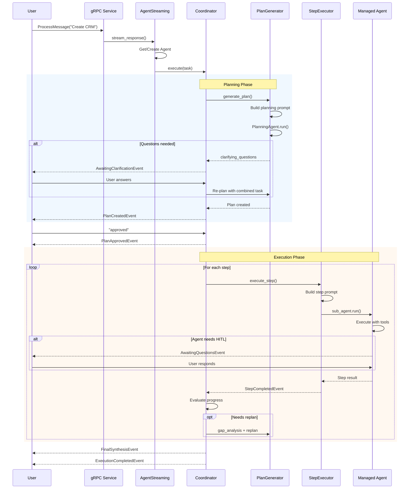
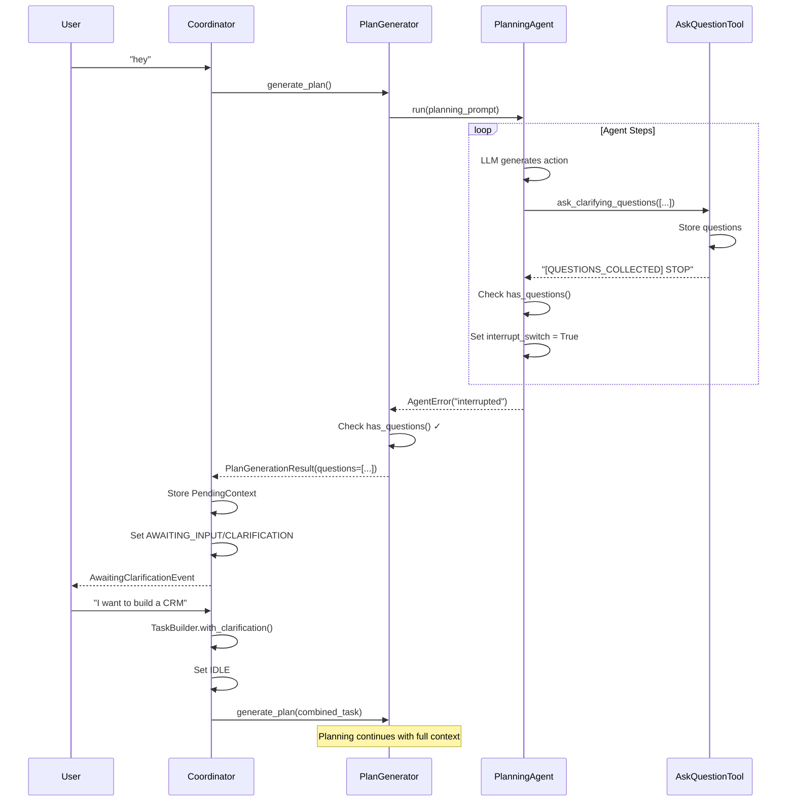

# Emery Agents: Complete Flow Documentation

## Overview

This document traces the complete data flow, agent lifecycle, and capability architecture.

---

# VISUAL DIAGRAMS

## Main Message Flow



## State Machine Transitions



## Prompt Composition Stack



## Capability Lifecycle



## Agent Hierarchy



## Context Objects Flow



## Complete Execution Flow



## Clarification Flow (Detailed)



---

# PART 1: PROMPT & CONTEXT FLOW

## 1.1 Entry Point to Prompt Build

```
USER MESSAGE
    ↓
ChatProcessingService.ProcessMessage()      [grpc/chat_processing_service.py:134]
    ↓
AgentStreamingHandler.stream_response()     [grpc/agent_streaming.py:112]
    ├─ HOT: Reuse agent from session        [line 164]
    └─ COLD: _create_agent_cold_path()      [line 180]
        ↓
        build_agent_instructions()          [prompts/__init__.py:500]
```

## 1.2 Prompt Composition Layers

**File**: `prompts/__init__.py:500-625`

```python
def build_agent_instructions(agent_type, execution_mode, phase, tools, **kwargs):
    # Layer 1: Base (cached) - lines 537
    instructions = get_cached_base_instructions(**kwargs)
    #   → shared/identity.j2
    #   → shared/critical_rules.j2
    #   → components/goal_persistence.j2

    # Layer 2: Capability - lines 540-559
    if agent_type != "default":
        # NEW: capabilities/{agent_type}/execution.j2
        # FALLBACK: agents/{agent_type}.j2

    # Layer 3: Mode - line 563
    #   → modes/{interactive|autonomous}.j2

    # Layer 4: Phase - line 573
    #   → phases/{planning|execution|evaluation}.j2

    # Layer 5: Tools - line 582
    #   → get_tool_instructions(tools)

    return instructions
```

## 1.3 Context Objects

| Context | File | Purpose |
|---------|------|---------|
| `SessionConfig` | `services/context.py:71-84` | Auth: org_id, api_key |
| `WorkspaceContext` | `services/context.py:86-145` | Data: databases, tables, apps |
| `ExecutionContext` | `entities/execution_context.py` | Runtime: tools, attachments, mode |
| `PendingContext` | `execution_coordinator.py:65-77` | Resumption: original_task, tools |

## 1.4 Context Flow Path

```
execute(task, tools)                           [execution_coordinator.py:589]
    ↓
create_plan(goal, instructions, tools)         [line 909]
    ├─ filter_tools_for_mode(tools, PLANNING)  [line 942]
    ├─ _build_workspace_context(tools)         [line 958]
    │   ├─ database_crud.forward(method='list')
    │   └─ table_crud.forward(method='list_tables')
    └─ plan_service.generate_plan(workspace=..., config=...)  [line 965]
        ↓
PlanGenerator.generate()                       [plan_generator.py:79]
    ├─ strategy_service.get_relevant_strategies()  [ACE]
    ├─ _build_planning_prompt(workspace=...)   [line 137]
    │   └─ render_template("planning/planner.j2", context=workspace)
    └─ PlanningAgent.run(prompt)               [line 158]
```

## 1.5 ACE Execution Context Evolution

```
execute_plan() init:
    ledger.init_execution_tracking()           [line 1151]
    ↓
After every 3 steps:
    _curate_context_if_needed()                [line 2027]
    ├─ ExecutionContextService.curate()
    │   ├─ Extract insights from step_results
    │   ├─ Deduplicate and prioritize
    │   └─ Decay old insights
    └─ Take evolution snapshot
    ↓
After execution completes:
    strategy_service.record_execution()        [line 1572]
    └─ Store proven patterns for future plans
```

---

# PART 2: AGENT FLOW

## 2.1 Agent Class Hierarchy

```
smolagents.ToolCallingAgent (base)
    │
    ├── PlanningAgent                          [agents/planning_agent.py:19]
    │   └─ Early exit when questions collected
    │   └─ Checks AskQuestionTool after each step
    │   └─ Sets interrupt_switch = True
    │
    └── InterruptAwareToolCallingAgent         [agents/interrupt_aware_agent.py:15]
        ├─ Mixes in HITLMixin
        ├─ execute_tool_call() catches interrupts
        └─ _handle_hitl_resume() for resumption
            │
            └─ Managed Agents:
               - SkillBuilderAgent
               - DocumentBuilderAgent
               - TableBuilderAgent
               - SchemaBuilderAgent
               - AppBuilderAgent
               - AgentBuilderAgent
               - ResearchAgent
               - User-defined agents
```

## 2.2 Agent Creation (Cold Path)

**File**: `grpc/agent_streaming.py:254-389`

```
_create_agent_cold_path()
    ↓
ManagedAgentsFactory                           [managed_agents_factory.py]
    ├─ create_skill_builder()                  [line 271]
    ├─ create_document_builder()               [line 274]
    ├─ create_table_builder()                  [line 277]
    ├─ create_schema_builder()                 [line 280]
    ├─ create_app_builder_agent()              [line 283]
    ├─ create_agent_builder_agent()            [line 286]
    ├─ create_research_agent()                 [line 293]
    └─ create_system_designer()                [line 318]
    ↓
create_chat_planner()                          [chat_planner_agent.py:36]
    └─ InterruptAwareToolCallingAgent(
           tools=all_tools,
           managed_agents=managed_agents,
           instructions=instructions
       )
    ↓
session_manager.register_agent()               [streaming.py:364]
session_manager.restore_agent_from_history()   [streaming.py:351]
    └─ agent.memory.steps.append(...)
```

## 2.3 Agent Execution Flow

```
agent.run(task, stream=True)                   [streaming.py:526]
    ↓
InterruptAwareToolCallingAgent.run()           [interrupt_aware_agent.py:21]
    ├─ _handle_hitl_resume(task)               [_hitl_mixin.py:49]
    │   └─ If interrupted: Call managed_agent(task)
    └─ super().run()
        ↓
smolagents step loop:
    ├─ PlanningStep: Agent reasoning
    ├─ ActionStep: Tool calls
    │   └─ execute_tool_call()                 [interrupt_aware_agent.py:28]
    │       └─ Catch "interrupted" → _handle_interrupt()
    └─ FinalAnswerStep: Completion
```

## 2.4 Managed Agent Invocation

**File**: `services/plan_step_executor.py:152-284`

```
PlanStepExecutor._execute_with_routing()
    ↓
Determine prompt:
    ├─ Autonomous: step_executor_autonomous.j2 (with resolved_prompt)
    └─ Interactive: step_executor_interactive.j2 (with description)
    ↓
sub_agent = ToolCallingAgent(
    tools=step_tools,
    managed_agents=self.managed_agents,        # All agents available
    model=self.model
)
    ↓
result = sub_agent.run(task=prompt)
    └─ Smolagents routes based on agent descriptions
       LLM reads name/description → selects agent → managed_agent(task)
```

## 2.5 State Machine

**File**: `services/coordinator_state_machine.py:38-51`

| Phase | Description |
|-------|-------------|
| IDLE | Ready for new task |
| AWAITING_CLARIFICATION | Waiting for user details |
| AWAITING_APPROVAL | Plan ready for review |
| AWAITING_QUESTIONS | Managed agent needs HITL |
| EXECUTING | Plan running |
| AWAITING_RECOVERY | Error recovery |

**Transitions**:
```
IDLE → AWAITING_CLARIFICATION | AWAITING_APPROVAL | EXECUTING
AWAITING_APPROVAL → EXECUTING | IDLE
EXECUTING → AWAITING_QUESTIONS | AWAITING_RECOVERY | IDLE
```

---

# PART 3: CAPABILITY FLOW

## 3.1 Capability Model

**File**: `models/capability.py:13-85`

```python
@dataclass
class Capability:
    id: str                    # "agent:schema_builder"
    name: str                  # "schema_builder"
    type: CapabilityType       # AGENT | SKILL | TOOL
    domain: str                # "emery" | "user" | "gmail"
    description: str           # Used by planner for routing
    actions: list[str]         # ["create", "update", "delete"]
    entities: list[str]        # ["tables", "fields"]
    metadata: dict             # {executor: agent_instance}
```

## 3.2 Capability Registry

**File**: `services/capability_registry.py:56-316`

| Method | Purpose |
|--------|---------|
| `register(capability)` | Add to registry |
| `get_enabled(org_id)` | Org's active capabilities |
| `search_enabled(query, org_id)` | Semantic search |
| `by_type(CapabilityType)` | Filter by AGENT/SKILL/TOOL |

## 3.3 System Capabilities Registered

**File**: `managed_agents_factory.py:862-956`

```
agent:skill_builder        - Creates and configures skills
agent:document_builder     - Creates documents
agent:table_builder        - Quick table modifications (autonomous)
agent:schema_builder       - Complex database schema design (HITL)
agent:app_builder          - Creates apps with pages/views
agent:page_builder         - Creates visual pages
agent:agent_builder        - Creates AI agents with skills
agent:research_agent       - Web search + system introspection
agent:discover_tools       - Integration discovery
agent:system_designer      - Orchestrates all builders
```

## 3.4 Capability Prompt Templates

**Directory Structure**:
```
prompts/capabilities/{name}/
    ├── planning.j2      # For planner discovery
    └── execution.j2     # For agent execution
```

**Loading Function**: `get_capability_instructions(capability_id, mode)`

```python
# prompts/__init__.py:628-766
def get_capability_instructions(capability_id, mode="execution"):
    name = capability_id.split(":")[-1]
    # Try: capabilities/{name}/{mode}.j2
    # Fallback: agents/{name}.j2
```

## 3.5 Capability Discovery Flow

```
1. PLANNER RECEIVES
   - User task
   - List of managed agents with descriptions
   - Capability discovery tools
   ↓
2. PLANNER READS planning.j2
   - Understands capability constraints
   - Knows step format for delegation
   ↓
3. PLANNER OUTPUTS
   PlanStep {
       target_agent: "schema_builder",
       description: "Create CRM schema..."
   }
```

## 3.6 Capability Execution Flow

```
ExecutionCoordinator receives step
    ↓
PlanStepExecutor._execute_with_routing()       [plan_step_executor.py:152]
    ├─ Looks up agent by target_agent name
    ├─ Renders step_executor_interactive.j2
    │   └─ Lists ALL managed agents
    ├─ Creates ToolCallingAgent with managed_agents
    └─ sub_agent.run(task=prompt)
        ↓
smolagents routing:
    ├─ LLM reads agent descriptions
    ├─ Routes to target agent
    └─ Agent executes with execution.j2 instructions
        ↓
Result returned to coordinator
```

## 3.7 Complete Capability Lifecycle

```
1. REGISTRATION
   ManagedAgentsFactory.create_*()
   └─ _register_agent_capability()
      └─ registry.register(Capability(...))

2. DISCOVERY (Planning)
   PlanGenerator.generate()
   └─ Planner sees agent descriptions
   └─ Reads planning.j2 for constraints
   └─ Sets target_agent in PlanStep

3. EXECUTION
   PlanStepExecutor.execute()
   └─ Routes via smolagents
   └─ Agent uses execution.j2 instructions
   └─ Tools execute with ExecutionContext

4. COMPLETION
   Result stored in step
   └─ Next steps can reference results
```

---

# PART 4: KEY FILE REFERENCE

## Entry Points
| File | Purpose |
|------|---------|
| `grpc/chat_processing_service.py` | gRPC entry, session setup |
| `grpc/agent_streaming.py` | Agent creation, streaming |

## Coordination
| File | Purpose |
|------|---------|
| `services/execution_coordinator.py` | Planning → approval → execution |
| `services/coordinator_state_machine.py` | Phase management |
| `services/coordinator_streaming.py` | Event streaming |

## Planning
| File | Purpose |
|------|---------|
| `services/planning/plan_generator.py` | Single-agent plan generation |
| `agents/planning_agent.py` | Early exit on questions |

## Execution
| File | Purpose |
|------|---------|
| `services/plan_step_executor.py` | Step routing and execution |
| `agents/interrupt_aware_agent.py` | HITL interrupt handling |
| `agents/_hitl_mixin.py` | HITL state management |

## Prompts
| File | Purpose |
|------|---------|
| `prompts/__init__.py` | Template loading and composition |
| `prompts/shared/` | Core templates (identity, rules) |
| `prompts/modes/` | Interactive vs autonomous |
| `prompts/phases/` | Planning, execution, evaluation |
| `prompts/capabilities/{name}/` | Capability-specific templates |

## Capabilities
| File | Purpose |
|------|---------|
| `models/capability.py` | Capability data model |
| `services/capability_registry.py` | Registry and lookup |
| `tools/capability_discovery.py` | Planner discovery tools |
| `grpc/agents/managed_agents_factory.py` | Agent creation and registration |

## Context
| File | Purpose |
|------|---------|
| `services/context.py` | SessionConfig, WorkspaceContext |
| `entities/execution_context.py` | Runtime context |
| `ace/models/execution_context.py` | ACE insights and curation |

---

# Summary

The system uses three interconnected flows:

1. **Prompt Flow**: Layered composition (base → capability → mode → phase → tools)
2. **Agent Flow**: Hierarchical agents with HITL interrupts and state machine coordination
3. **Capability Flow**: Registry-based discovery with planning.j2 and execution.j2 templates

All flows converge through the ExecutionCoordinator, which orchestrates the complete lifecycle from user message to final response.
